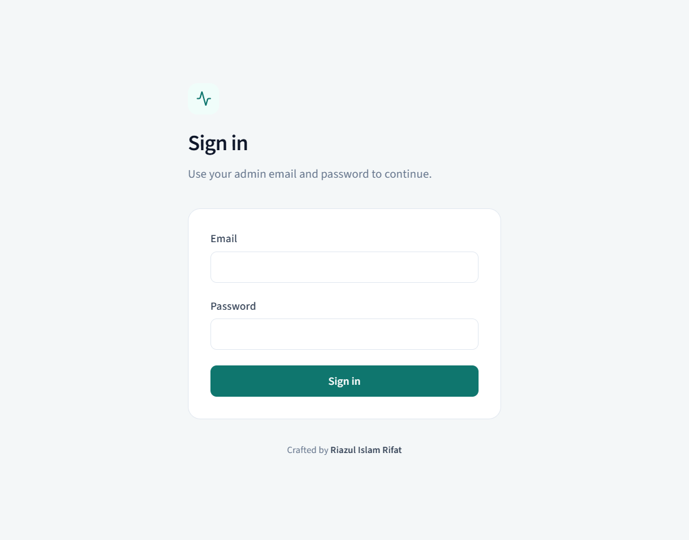
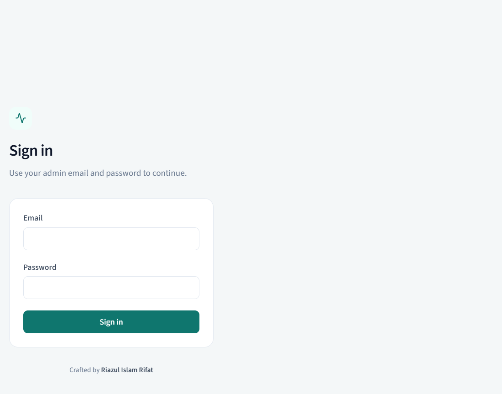
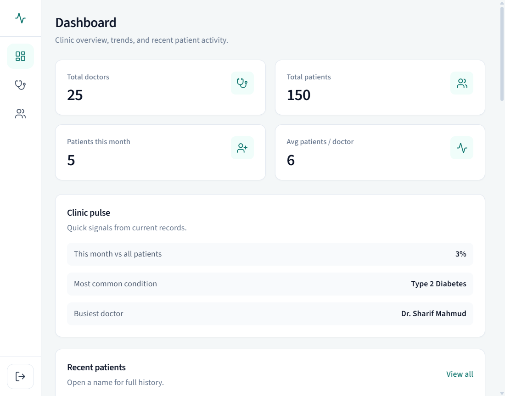
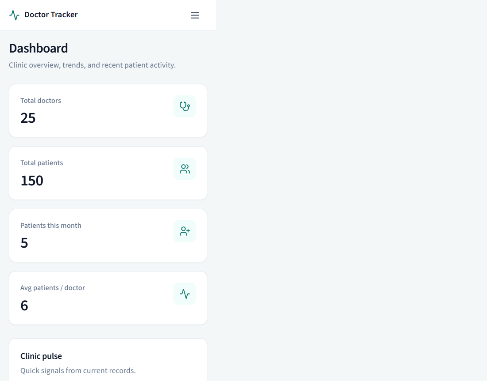
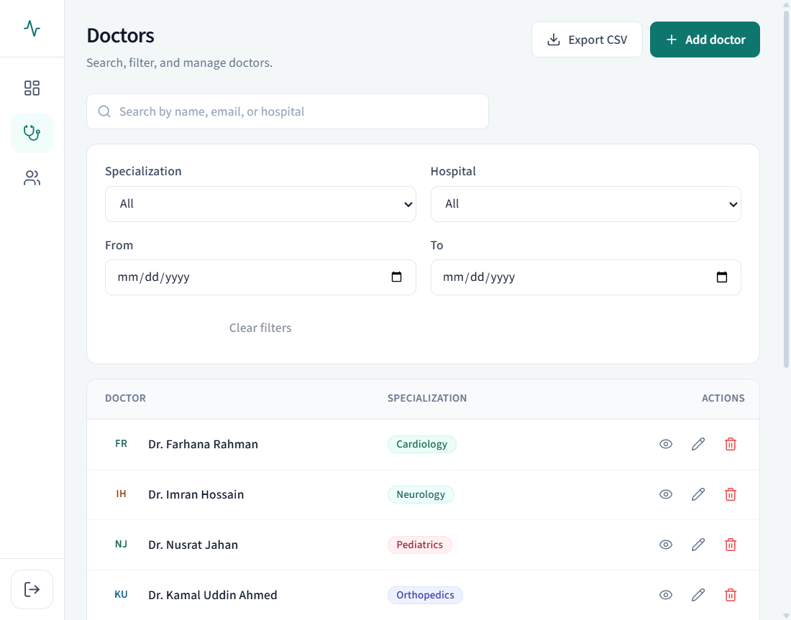
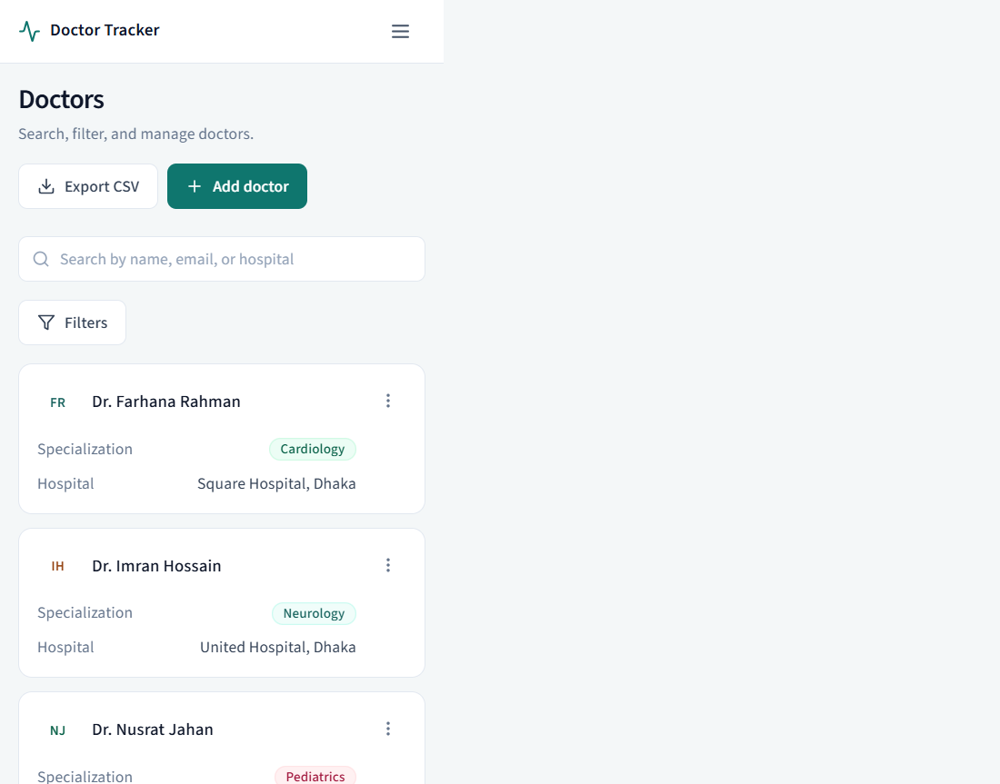
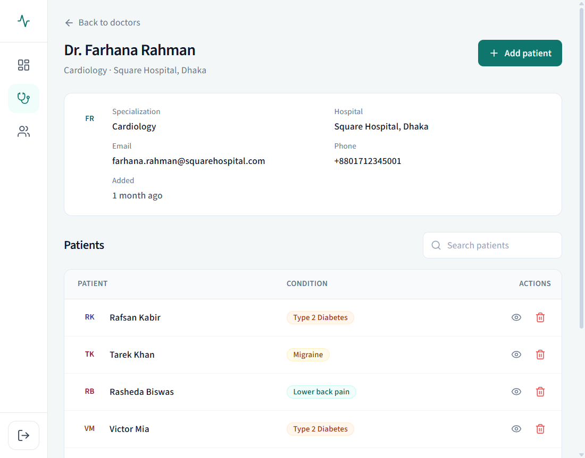
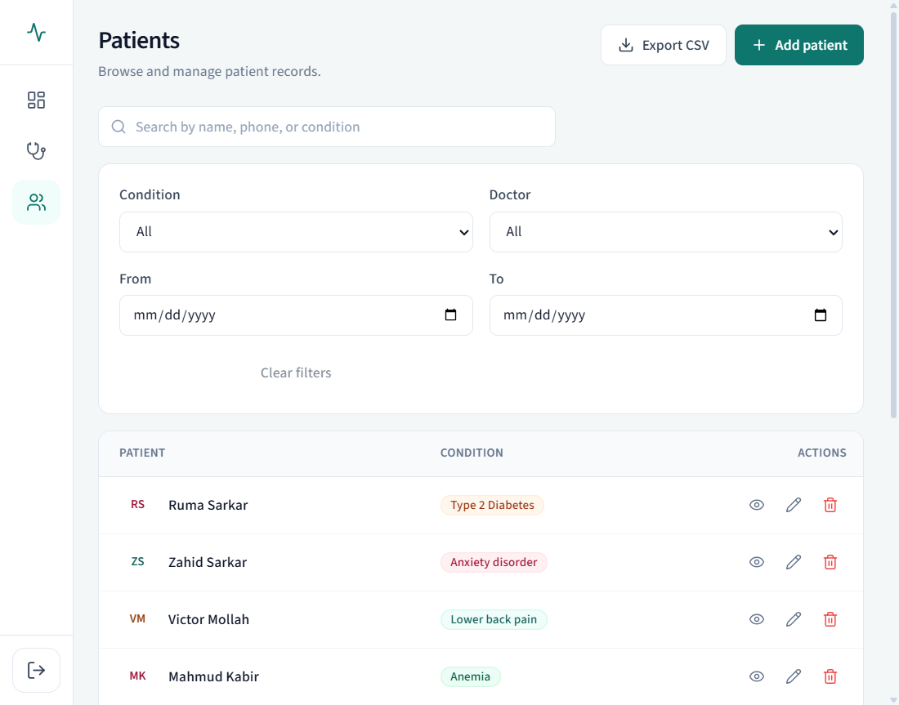
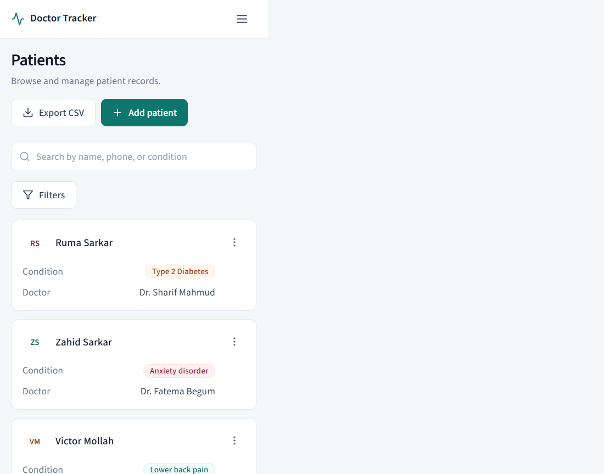

# Doctor Tracker — Frontend

Next.js admin UI for managing doctors and patients, with search/filter, pagination, and a clinic analytics dashboard.

**Backend repo:** [doctor-tracker-backend](https://github.com/code-with-rifat/doctor-tracker-backend)

## Stack

- Next.js (App Router)
- TypeScript
- Tailwind CSS
- TanStack Query
- React Hook Form + Zod
- Recharts

## Setup

Requirements: Node.js 18+

1. Start the backend API first (see backend repo). Default: `http://localhost:5000`
2. Configure env (copy example only — never commit real secrets):

```bash
copy .env.example .env.local
```

`.env.example`:

```
NEXT_PUBLIC_API_URL=http://localhost:5000/api
```

3. Install and run:

```bash
npm install
npm run dev
```

App: [http://localhost:3000](http://localhost:3000)

### Demo admin

- Email: `demo@doctortracker.com`
- Password: `Demo@123`

Create this account and sample records in the backend with `npm run seed-demo`.
The command preserves existing records. The login page also offers a demo-login
button during development.

## Deploy (Vercel)

1. Import this repo into Vercel
2. Set env:

```
NEXT_PUBLIC_API_URL=https://<your-backend-url>/api
```

3. Deploy

## Features

- Admin login (JWT httpOnly cookie via API)
- Doctors CRUD + search / filter / pagination
- Patients CRUD + search / filter / pagination
- Doctor detail with assigned patients
- Dashboard stats + charts
- CSV export
- Responsive desktop / mobile UI

## Visual Evidence

### Login

| Desktop | Mobile |
|---------|--------|
|  |  |

### Dashboard

| Desktop | Mobile |
|---------|--------|
|  |  |

### Doctors

| Desktop | Mobile |
|---------|--------|
|  |  |

### Doctor detail



### Patients

| Desktop | Mobile |
|---------|--------|
|  |  |

## Author

Riazul Islam Rifat
